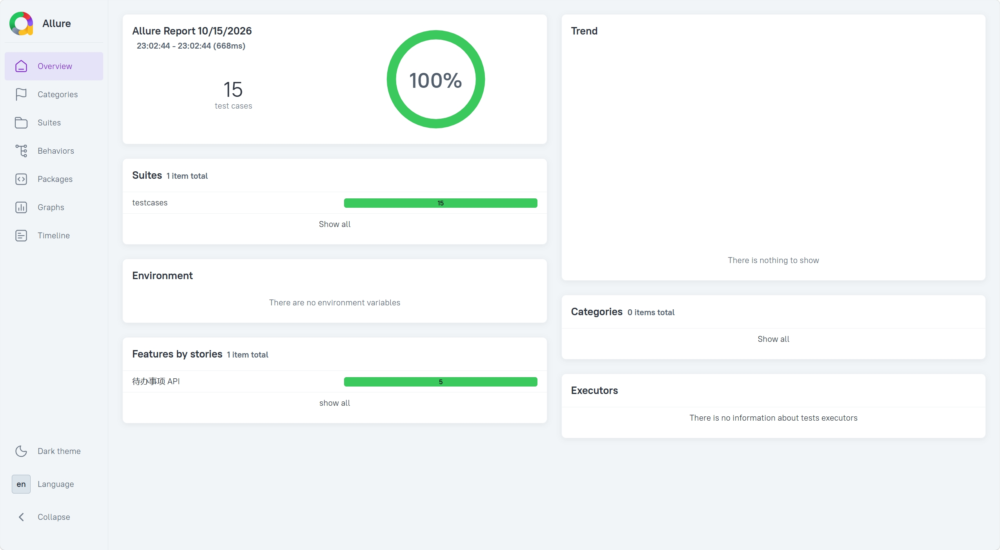

# 待办事项 API 接口自动化测试框架

[](https://github.com/xiuxiaoyin/xiu/actions/workflows/test.yml)

## 简介

针对一个待办事项（Todo）后台 API 的接口自动化测试框架。

被测服务用 Flask 实现，包含 5 个 RESTful 接口；测试侧基于 pytest 搭建，
覆盖成功路径、参数校验、错误码、资源不存在等 15 条用例，支持 yaml 数据驱动、
Allure 可视化报告和 GitHub Actions 持续集成。

## 技术栈

Python 3.14 · pytest · requests · PyYAML · Allure · GitHub Actions · Flask

## 项目结构

```
Internship_program/
├─ .github/workflows/test.yml ← CI 流水线（push 自动跑测试）
├─ common/ ← 配置层 + 工具层 + 请求层
│   ├─ config.py BASE_URL / PROJECT_ROOT
│   ├─ utils.py load_cases
│   └─ http_client.py 统一请求入口（超时 + 日志）
├─ testcases/ ← 15 条用例，按业务分 4 个文件
├─ test_data/ ← yaml 数据驱动
├─ conftest.py ← 共享 fixture
├─ pytest.ini ← pytest 配置（含日志）
├─ app.py ← 被测系统
├─ test-table/设计.md ← 接口规格文档
└─ requirements.txt / .gitignore
```

## 如何运行

前置要求：Python 3.14+

```bash
# 1. 安装依赖
pip install -r requirements.txt

# 2. 启动被测服务（另开一个终端，保持运行）
python app.py

# 3. 运行测试
pytest -q

# 4. 生成并查看测试报告
pytest --alluredir=./allure-results --clean-alluredir
allure serve ./allure-results
```

## 测试报告截图



## 设计要点

**为什么测试数据能自动清理？**
用 `autouse=True` 的 fixture，在每条用例前后都清空环境。
保证用例之间互不干扰——无论上一条成功还是失败，下一条都从干净状态开始。

**为什么用例数据放在 yaml 而不是代码里？**
参数校验用例的数据全部放在 `test_data/`，用例代码只负责发请求和断言。
好处：新增场景只改数据、不动代码；非开发同学也能贡献用例。

**为什么所有请求都走统一的请求层？**
用例不直接调 requests，而是走 `common/http_client.py`。
好处：接口地址只维护一处、所有请求统一带超时、自动记录请求/响应日志方便排查。
